# VibeOS

**VibeOS is a GNOME-based operating system for touch devices.** It turns GNOME into a system you use with your
fingers: a home screen with pages, a dock and an app drawer, gesture navigation, recents, a status bar, a
notification shade with quick settings, a lock screen with a PIN pad, an always-on display, and its own set of apps
written in GTK 4. Underneath it is plain Debian and GNOME — the same GNOME Shell, mutter, GLib, GTK, systemd,
NetworkManager, ModemManager, PipeWire and evolution-data-server as on a desktop — so every GNOME app runs on it,
and every VibeOS app runs on any Mobian or Debian device with the stock services. It speaks English, German, Spanish,
French, Italian, Dutch and Russian: the shell, the launcher and every app.

<p align="center">
  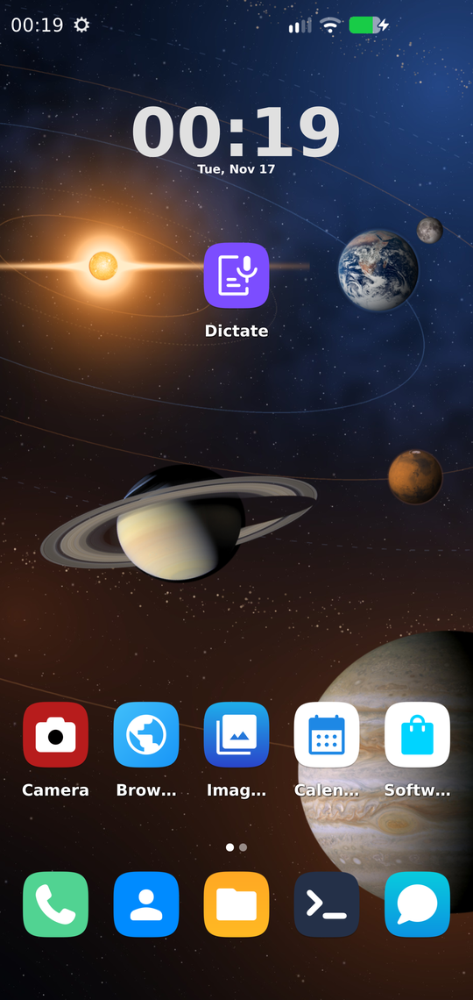
  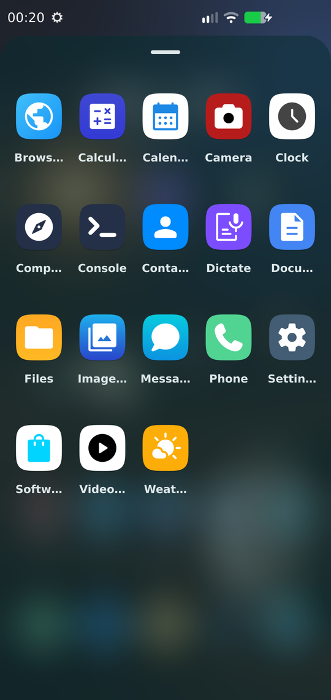
  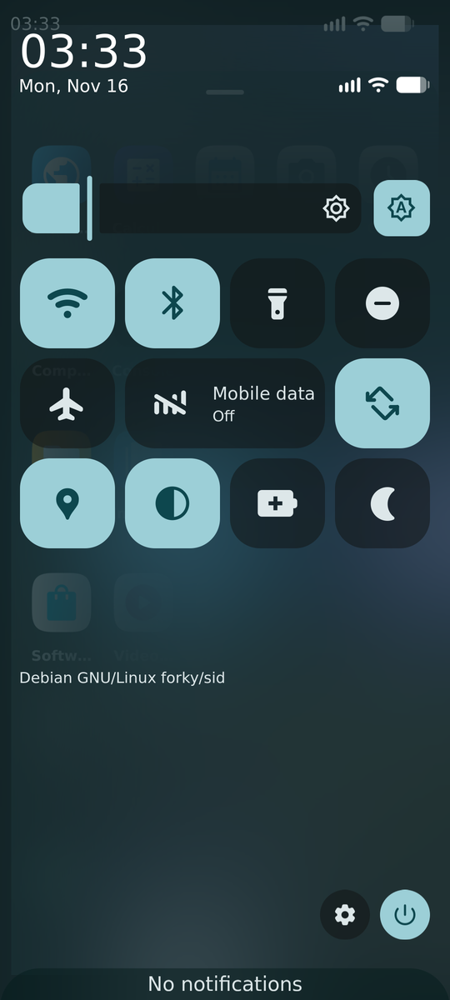
  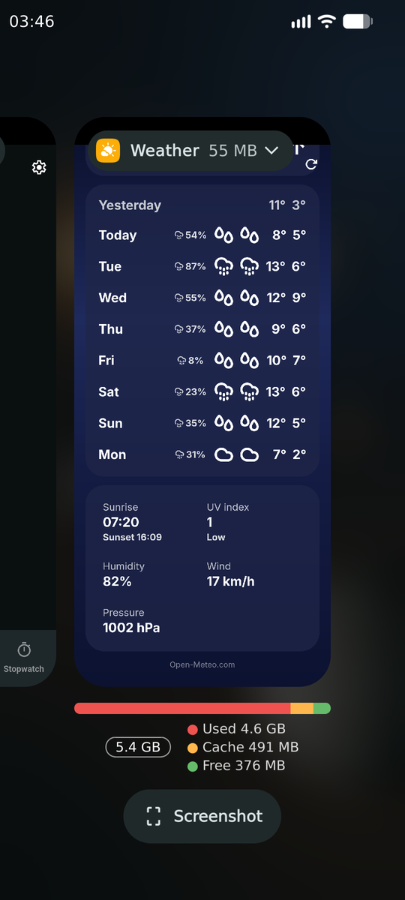
  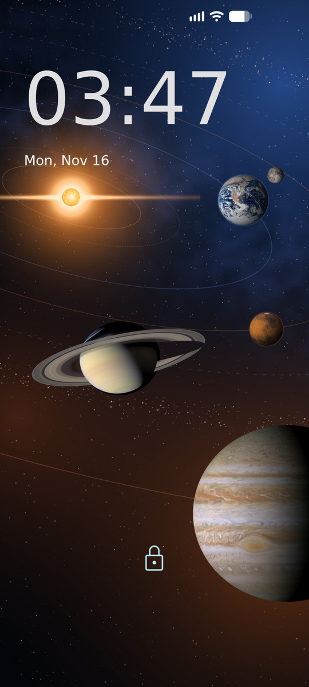
</p>

## Where it runs

| Device class | Status |
|---|---|
| **Phones** | In daily use: Samsung Galaxy S10e, POCO X3 NFC and Samsung Galaxy S20 FE, on mainline Linux (the S20 FE without Bluetooth and the cameras yet). The OnePlus 6T has a device zip converted from Nura's build, not yet installed on one |
| **Tablets** | Being brought up: the Samsung Galaxy Tab S5e (Wi-Fi), which VibeOS lays out as a tablet (two panes, a navigation rail and a taskbar), and the Xiaomi Pad 5 (cameras: coming in 0.1.5; image: coming) |
| **Desktops and laptops with a touch screen** | Planned: the same shell and apps, with a docked desktop for keyboard and mouse |
| **TV boxes** (like Android TV) | Planned: a remote-friendly home screen on the same base |

## The apps

<table>
<tr><td></td><td><b>Phone</b> (<code>vibeos-dialer</code>)</td><td>Calls through ModemManager: favourites, recents, the dialpad, the call log, blocked numbers, the in-call and incoming-call screens; calls ring with the app closed</td></tr>
<tr><td></td><td><b>Messages</b> (<code>vibeos-messaging</code>)</td><td>SMS through ModemManager: conversations, the composer, forwarding, archiving, blocked contacts; messages are notified with the app closed</td></tr>
<tr><td></td><td><b>Contacts</b> (<code>vibeos-contacts</code>)</td><td>The contact list, a contact's details and the editor, on evolution-data-server's address books</td></tr>
<tr><td></td><td><b>Browser</b> (<code>vibeos-browser</code>)</td><td>A mobile browser on WebKitGTK 6: tab grid, bottom toolbar, incognito, home screen shortcuts</td></tr>
<tr><td></td><td><b>Camera</b> (<code>vibeos-camera</code>)</td><td>Photos, videos and barcode scanning on libcamera and GStreamer, with flash, timer, grid and level</td></tr>
<tr><td></td><td><b>Video Player</b> (<code>vibeos-video</code>)</td><td>Videos on mpv under an Android player's controls: a tap shows them, a double tap skips 10 seconds, a slide over the picture sets the volume or the brightness, and where a film was left is remembered; H.264 and HEVC on the device's hardware decoder where it has one, films on a share through GVfs</td></tr>
<tr><td></td><td><b>Files</b> (<code>vibeos-files</code>)</td><td>A file manager on GIO and GVfs: storage, removable media, the recycle bin, recent files, SMB/SFTP/FTP/WebDAV</td></tr>
<tr><td></td><td><b>Clock</b> (<code>vibeos-clock</code>)</td><td>Alarms and timers that ring with the app closed and wake the device from suspend, world clocks, the stopwatch</td></tr>
<tr><td></td><td><b>Calendar</b> (<code>vibeos-calendar</code>)</td><td>Day, month and agenda views and the event editor on evolution-data-server; reminders notify with the app closed</td></tr>
<tr><td></td><td><b>Calculator</b> (<code>vibeos-calculator</code>)</td><td>Exact real arithmetic that keeps every digit you scroll to, history, and the advanced pad</td></tr>
<tr><td></td><td><b>Weather</b> (<code>vibeos-weather</code>)</td><td>The weather where you are, or in a city you set: the next 24 hours, the week and the details, from Open-Meteo, the place from GeoClue</td></tr>
<tr><td></td><td><b>Compass</b> (<code>vibeos-compass</code>)</td><td>A compass with the heading from iio-sensor-proxy and the position from GeoClue</td></tr>
<tr><td></td><td><b>Navi</b> (<code>vibeos-navi</code>)</td><td>Turn-by-turn directions for driving on a vector map drawn by MapLibre Native: routes with lanes, speed limits and speed cameras, spoken prompts, search with a microphone, saved places and a reminder to leave; standing, the arrow points by the compass</td></tr>
<tr><td></td><td><b>Dictate</b> (<code>vibeos-dictate</code>)</td><td>Speech to text on the device itself, with nothing sent anywhere, in English, German, Spanish, French, Italian or Russian</td></tr>
<tr><td></td><td><b>Vibe</b> (<code>vibeos-dictate</code>)</td><td>An assistant you talk to, by holding the power key: it answers aloud, turns on the torch and the phone's switches, searches the web and finds a place's opening hours on OpenStreetMap; the answers come from a language model on VibeOS's server</td></tr>
<tr><td></td><td><b>Software</b> (<code>vibeos-software</code>)</td><td>The app store, on the VibeOS store at vibeos.top: featured apps, apps and games by category, search, an app's page with screenshots, ratings and reviews, updates and Update all, and a store account to review apps and see them on every device. Installing, updating and uninstalling go through App Installer</td></tr>
<tr><td></td><td><b>App Installer</b> (<code>vibeos-installer</code>)</td><td>Installs .deb files tapped in Files, and installs and uninstalls apps from the software sources for Software (its D-Bus interface): shows the app, both versions when one is installed, and what else changes, before anything does; PackageKit installs, polkit asks</td></tr>
<tr><td></td><td><b>Settings</b> (<code>vibeos-settings</code>)</td><td>Settings made for touch: Wi-Fi, Bluetooth, mobile network and hotspot, sounds, notifications, display, battery, wallpaper and parallax, the home screen, the lock screen (PIN, pattern, password), location, accounts, apps, language, accessibility. VibeOS opens it wherever GNOME opens a Settings panel</td></tr>
<tr><td></td><td><b>Terminal</b> (<code>vibeos-terminal</code>)</td><td>The shell in GNOME's terminal widget (VTE), made for touch: the keyboard comes up over it with a row of Esc, Tab, Ctrl, Alt and the arrows; a long press selects, with handles and Copy and Paste; one finger or two scroll, as a mouse wheel would in less, vim or htop; a pinch zooms the text</td></tr>
</table>

<p align="center">
  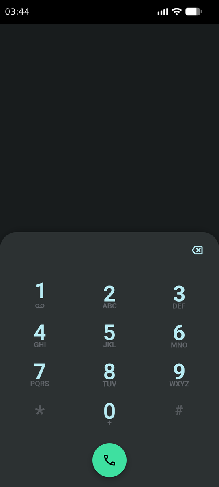
  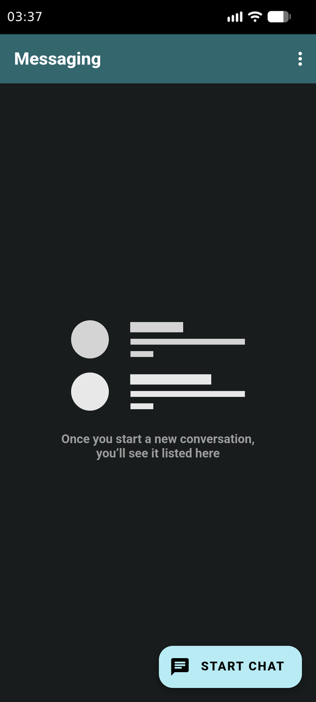
  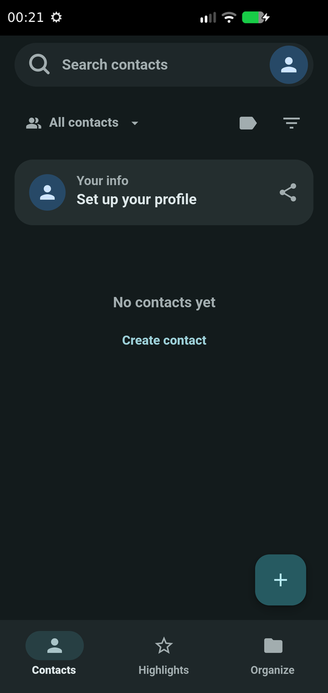
  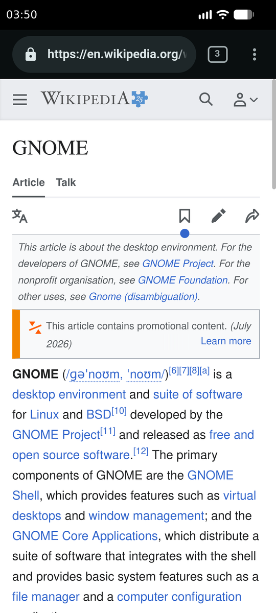
  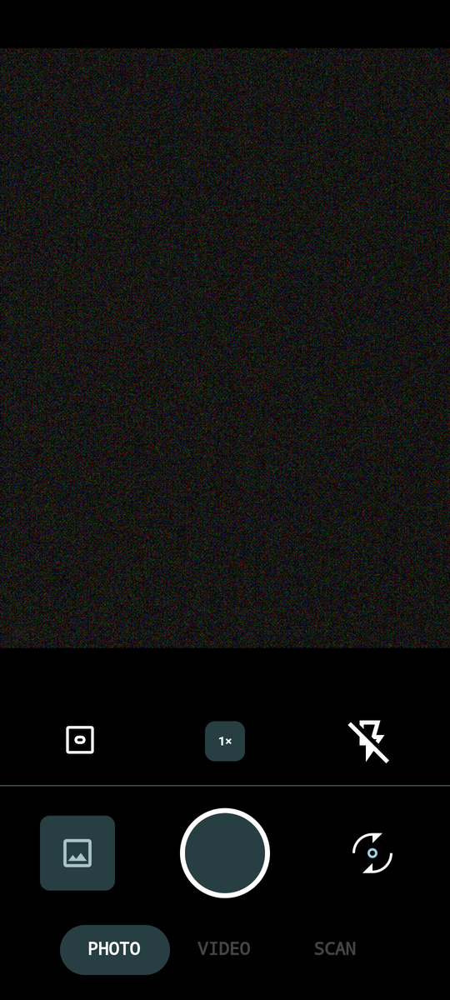
</p>
<p align="center">
  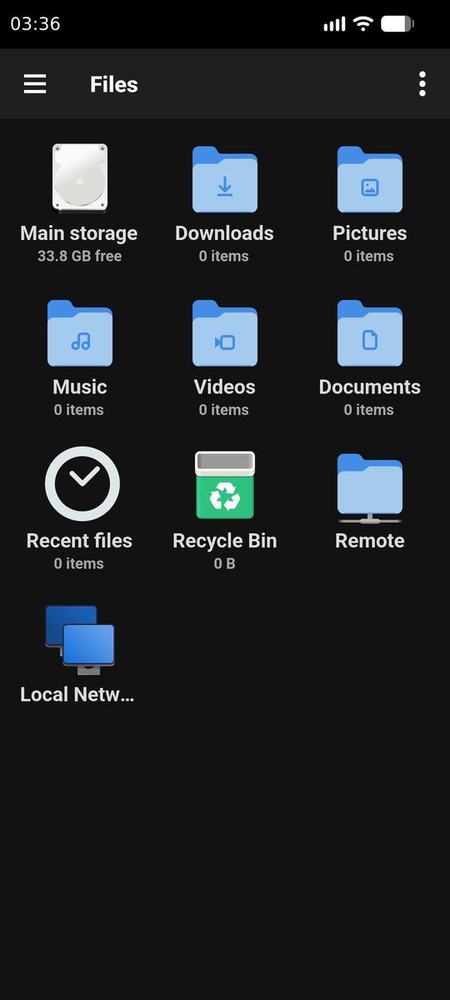
  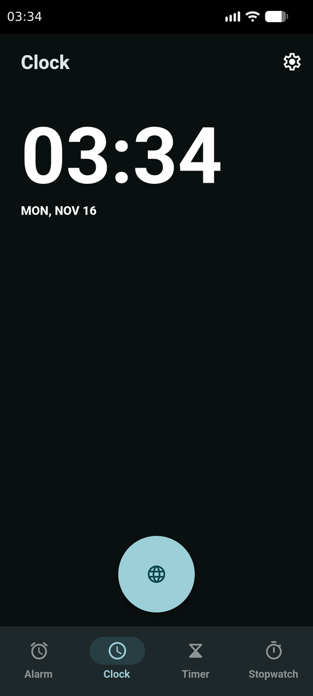
  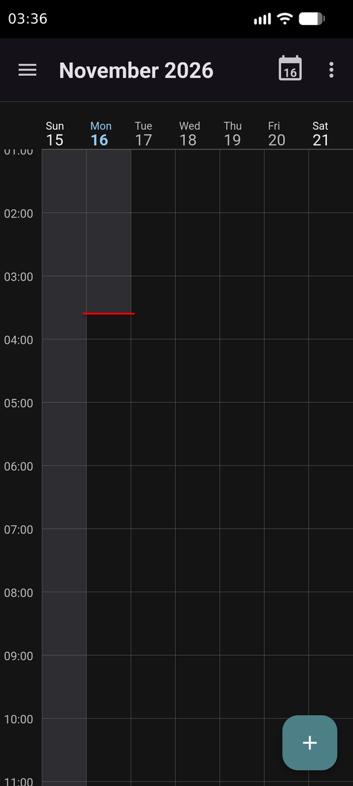
  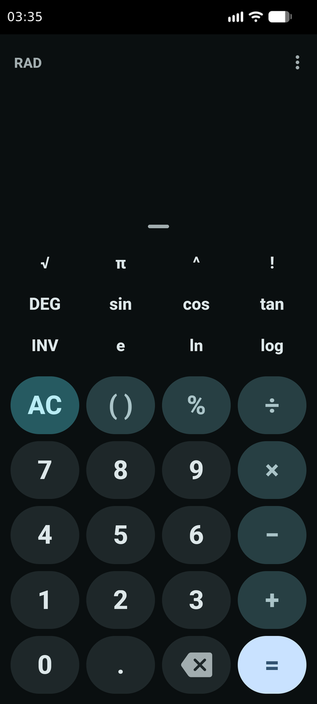
  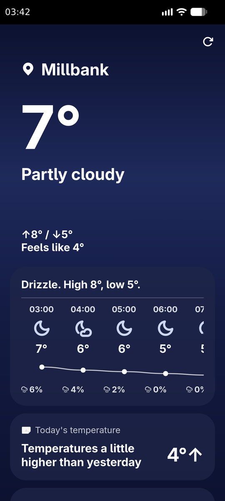
</p>
<p align="center">
  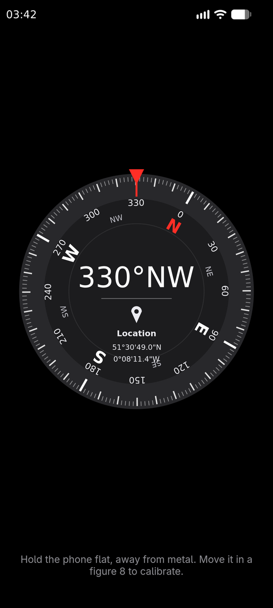
  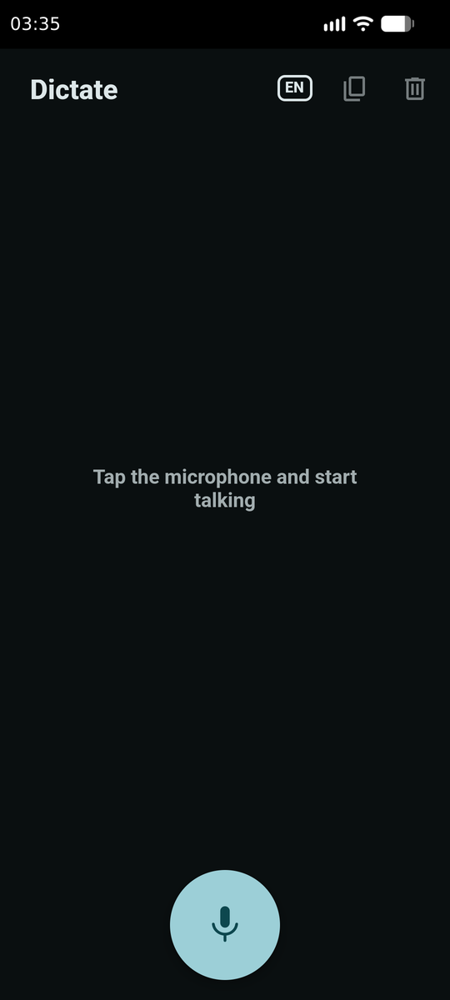
  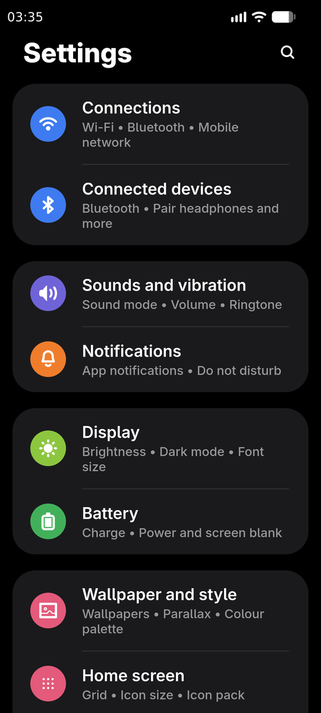
  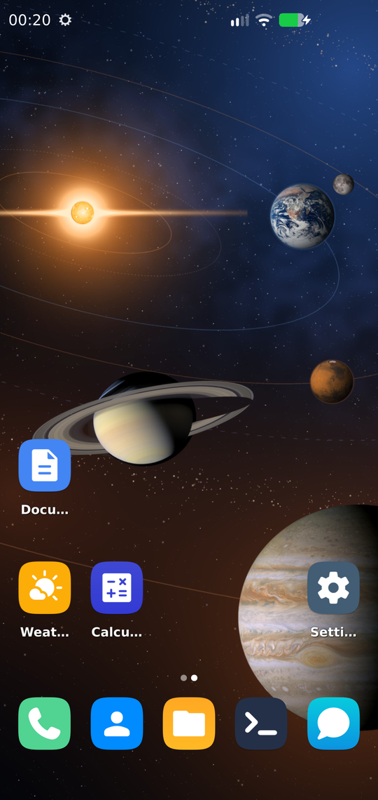
  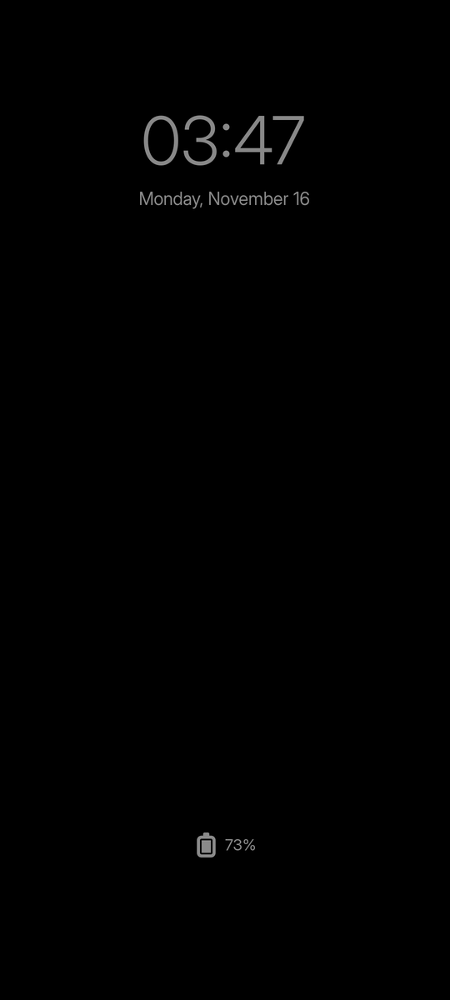
</p>

## How it is built

VibeOS is not a shell of its own and does not use Phosh. It is:

- **a GNOME Shell extension** (`shell@vibeos`) that replaces the shell's top panel, overview and lock screen with a
  touch device's: gesture navigation (swipe up for home and recents, in from an edge for back), the status bar, the
  shade and quick settings, heads-up notifications, the lock screen and PIN pad, the always-on display, rotation;
- **a session** (`vibeos`) for GDM, or a systemd unit for a device without a display manager;
- **the VibeOS launcher**, the home screen: a Wayland client drawn with Vulkan, or OpenGL ES where the GPU has no
  Vulkan driver, with pages, a dock, an app drawer that follows the finger, widgets, icon packs and icon shapes, and
  tilt-parallax wallpapers;
- **the apps** above, in GTK 4 with their own Material 3 widgets (`libvibeos`, `libspongy`);
- **system helpers**: the lock screen's PIN check (PAM), waking from suspend for alarms and reminders, a GPU clock
  boost while the screen is touched, and a mobile data profile for every new SIM.

**Which GNOME Shell.** Phones run GNOME Shell's mobile branch: gnome-shell-mobile and mutter-mobile, branch mobile-51
(GNOME Shell 51.1.mobile.22), built into `/opt/gnome-mobile`. Debian's own gnome-shell 51.0 loads the extension, but
on a phone it crashes (SIGSEGV) right after the lock screen is unlocked. These packages do not include the mobile
shell; the device images do.

## Packages

| Package | What it is |
|---|---|
| `vibeos` | Metapackage: the extension, the session, the launcher and the apps |
| `gnome-shell-extension-vibeos` | The GNOME Shell extension |
| `vibeos-session` | The "VibeOS" session (GDM, or a systemd unit with no display manager) |
| `vibeos-daemons` | The PIN check, alarm wake-ups, the touch GPU boost, and the system colours (`vibeos-theme`) |
| `vibeos-launcher` | The home screen |
| `vibeos-dialer`, `vibeos-messaging`, `vibeos-contacts`, `vibeos-browser`, `vibeos-camera`, `vibeos-files`, `vibeos-clock`, `vibeos-calendar`, `vibeos-calculator`, `vibeos-weather`, `vibeos-compass`, `vibeos-dictate`, `vibeos-software`, `vibeos-installer`, `vibeos-settings`, `vibeos-terminal`, `vibeos-video` | The apps |
| `vibeos-navi` | Navi, car navigation with MapLibre Native inside; built on its own by `apps/navi/pkg/build-deb.sh` |
| `vibeos-sandbox` | The sandbox the apps installed from Software run in, with Android's permissions: they ask for the camera, the microphone and the location |
| `vibeos-iconpack-vibeos` | The VibeOS icons, the default: large Material Symbols glyphs on squircles in each app's colour |
| `vibeos-iconpack-gnome-free` | gnome-free (called Round before): white glyphs on gradient discs |
| `vibeos-parallax-solar-system` | The default wallpaper: a tilt-parallax solar system from NASA's public-domain images |
| `sim-apn` | Sets up a mobile data profile for every new SIM |
| `vibeos-unifiedpush` | Push messages for the apps: one connection to the push server for all of them (UnifiedPush) |
| `libvibeos-1-0`, `libspongy-1-0`, `libspongy-gtk-1-0`, `gir1.2-spongy-1`, `fonts-vibeos-roboto` | The apps' Material 3 widgets, Android-style scroll physics, and Roboto |

Dictate's speech recognisers are [Moonshine](https://github.com/moonshine-ai/moonshine) (MIT; English, German,
Spanish, with punctuation) and [Vosk](https://alphacephei.com/vosk/) (Apache-2.0; French, Italian, Russian). They are
not built from this tree: `tools/vibeos-dictate-speech/build-debs.sh` packages their own releases as
`vibeos-dictate-moonshine`, `vibeos-dictate-vosk` and one package per language (`vibeos-dictate-en`,
`vibeos-dictate-de`, …). The release carries them.

The release also carries **mutter 51.0-3+gp1**: Debian's mutter 51.0-3 with the five patches in
[`patches/mutter`](patches/mutter). A phone needs two of them: one keeps the panel powered for the always-on
display, the other lets a 1080x2280 panel use scale 3. Without them VibeOS still runs, but with no always-on
display and at scale 2.5. All five patches do nothing on a desktop.

[`patches/`](patches/README.md) holds the source changes of every open-source package VibeOS ships in a changed
build (mutter, the mobile shell, ModemManager, libcamera, WebKitGTK, iio-sensor-proxy, hexagonrpc), with the
version each applies to, how to rebuild it, and where it ships.

## Requirements

- Debian unstable (sid) or Mobian staging, arm64, with GNOME Session 51 and GNOME Shell 51. On a phone that means
  the mobile branch in `/opt/gnome-mobile` (see above), started by a drop-in for the session's shell unit,
  `/etc/systemd/user/org.gnome.Shell@vibeos.service.d/50-mobile.conf`:

  ```ini
  [Service]
  ExecStart=
  ExecStart=/opt/gnome-mobile/bin/gnome-shell --mode=%i
  Environment=GSETTINGS_SCHEMA_DIR=/opt/gnome-mobile/share/glib-2.0/schemas
  ```
- A device with a working mainline kernel: display and touch, and ModemManager for calls and SMS on a phone
- Vulkan or OpenGL ES 3.0 for the launcher (Mesa: panvk or Panfrost on Mali, Turnip or freedreno on Adreno; on the
  CPU alone, with lavapipe, it works, slowly)

## Install

The simplest way is the signed apt archive at vibeos.top, which also brings every later release:

```sh
sudo curl -fsSLo /usr/share/keyrings/vibeos-archive-keyring.gpg \
  https://vibeos.top/apt/vibeos-archive-keyring.gpg
sudo curl -fsSLo /etc/apt/sources.list.d/vibeos.sources \
  https://vibeos.top/apt/vibeos.sources
sudo apt update
sudo apt install vibeos vibeos-navi
```

The key's fingerprint is `0802 5010 73FA FEAC CFF5 B808 FF24 1881 81F7 82CB`. The archive's `main` has the VibeOS
packages; the patched mutter is in its own component, `mutter`, for those who add it.

Or download the `.deb` files from the [latest release](https://github.com/pulpoff/vibeos/releases/latest) into an
empty folder, check them against `SHA256SUMS`, then:

```sh
sha256sum -c SHA256SUMS
sudo apt install ./*.deb
sudo apt-mark hold libmutter-51-0 gir1.2-mutter-51 mutter-common mutter-common-bin
```

The hold keeps the patched mutter from being replaced by Debian's at the next upgrade. Skip the mutter `.deb` files
and the hold if you want Debian's stock mutter. Skip the `vibeos-dictate-*` speech packages you do not need: each
language's model is large.

Then choose **VibeOS** in the session menu at the GDM login screen. To make it the default for automatic login:

```sh
busctl call org.freedesktop.Accounts /org/freedesktop/Accounts/User$(id -u) \
    org.freedesktop.Accounts.User SetSession s vibeos
```

To run without a display manager, see `/usr/share/doc/vibeos-session/README.Debian`.

## Not in these packages

- **Device support.** Kernel, firmware, modem and sensor setup, the camera hole's position, and audio routing belong
  in a per-device package. The camera hole is read from libgmobile's display-panel data, or from
  `/etc/gmobile/display-panels/<compatible>.json`.
- **The mobile GNOME Shell** (see [How it is built](#how-it-is-built)). The device images carry it in
  `/opt/gnome-mobile`.
- **Other icon packs and parallax wallpaper sets.** Only VibeOS, gnome-free and the NASA solar system are here.
  VibeOS finds icon packs in `vibeos-launcher/iconpacks` and parallax sets in `vibeos-launcher/parallax`, in
  `~/.local/share` or any system data directory (`/usr/share`), and VibeOS Settings lists both.
- **Android's ringtones.** The dialer falls back to the freedesktop sound theme's ringtone.

## Build from source

```sh
sudo apt build-dep .
dpkg-buildpackage -b -uc -us
```

Each part (`libvibeos`, `libspongy`, `extension`, `session`, `vibeos-launcher`, `apps/*`) is its own
meson project, and `debian/rules` builds them in order.

## Installer images

The installer images on [vibeos.top/releases](https://vibeos.top/releases) (one system zip for every phone, and a
device zip for each phone, both installed from LineageOS's recovery) are made with the tools in
[`image/`](image/README.md). [`image/nura/`](image/nura/README.md) makes a device zip for a phone that
[Nura](https://nura.eco) (postmarketOS) has a build for, whichever flavour it runs.

## License

VibeOS's own code is under the [MIT license](LICENSE). Icons, images and the world-clock table converted from AOSP
and LineageOS are Apache-2.0, as are the Material Symbols glyphs of both icon packs. The solar-system wallpaper's
planets, Moon and Sun are NASA's public-domain images; its README credits each one. The calculator's constructive
reals are under the SGI/HP CRCalc notice, and Roboto is OFL-1.1. [`debian/copyright`](debian/copyright) lists every
file. The patches in [`patches/`](patches/README.md) are under the licences of what they change (the mutter patches
are GPL-2.0-or-later, like mutter); each folder's README names its licence.
